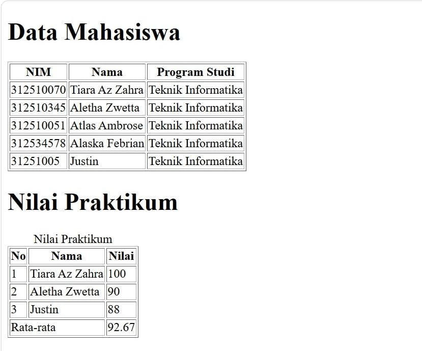
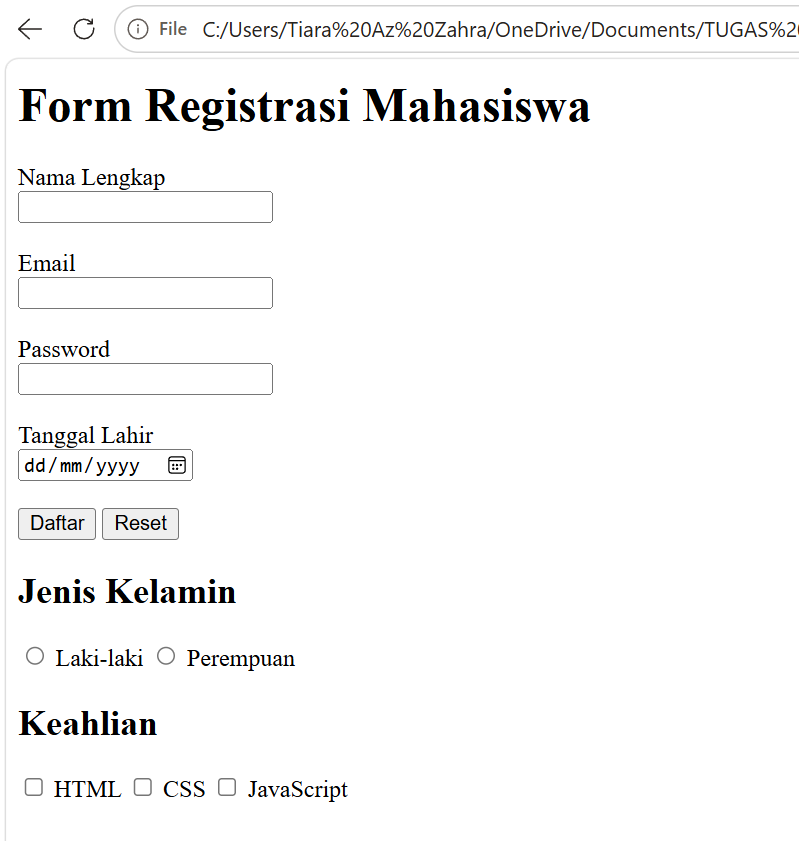
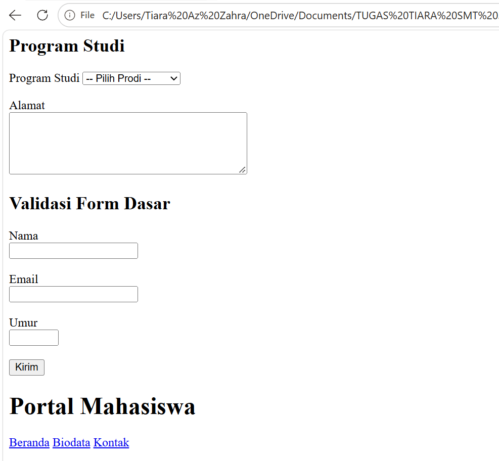
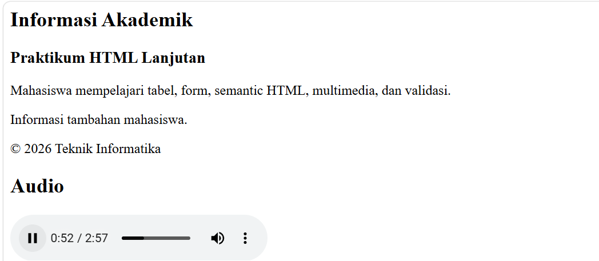
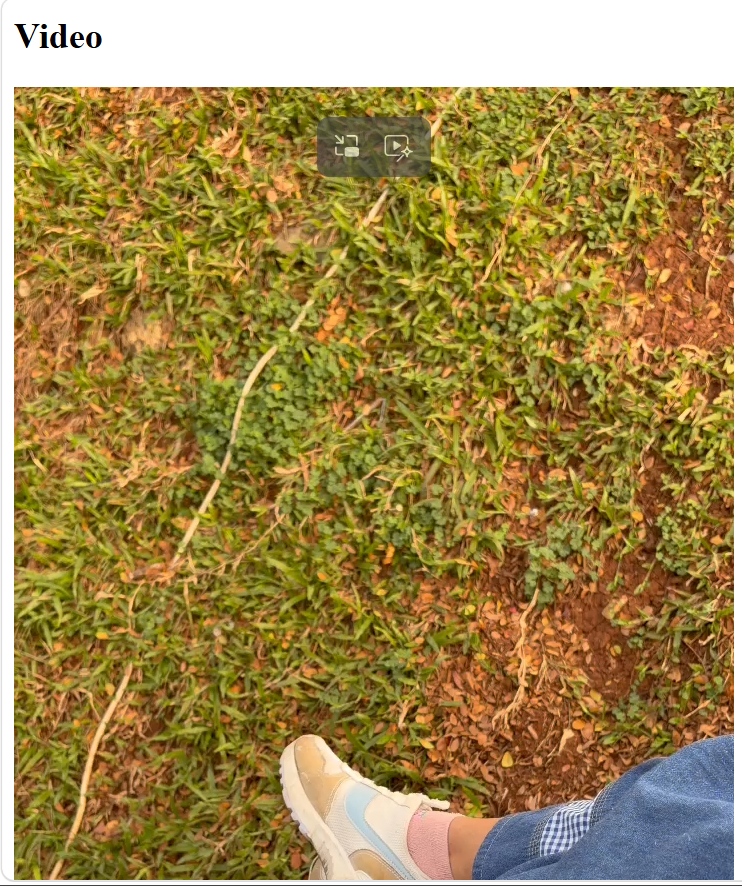
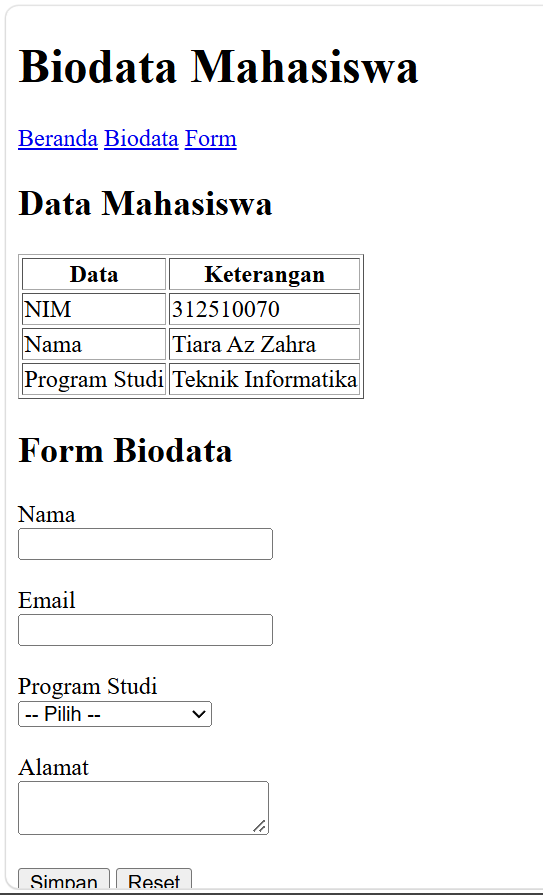
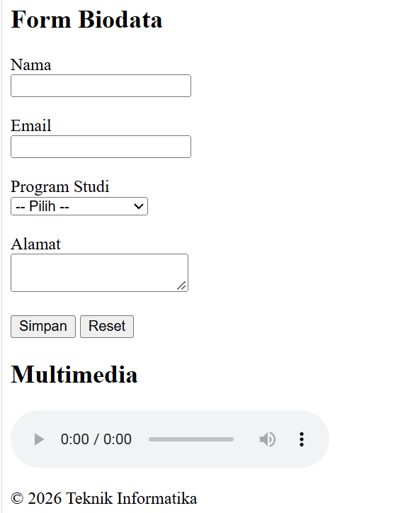

# Praktikum 2 - HTML Lanjutan

## Identitas

- **Nama:** Tiara Az Zahra
- **Program Studi:** Teknik Informatika
- **Universitas:** Universitas Pelita Bangsa
- **Mata Kuliah:** Pemrograman Web

## Deskripsi Praktikum

Pada praktikum ini, saya mempelajari penggunaan HTML lanjutan untuk membuat halaman web. Materi yang dikerjakan meliputi tabel, formulir, validasi input, elemen semantik, penambahan audio dan video, serta pembuatan halaman biodata mahasiswa.

## Tujuan Praktikum

1. Memahami penggunaan tabel pada HTML.
2. Membuat formulir dengan berbagai jenis input.
3. Memahami validasi pada formulir.
4. Mengenal elemen semantik HTML.
5. Menambahkan audio dan video ke halaman web.
6. Membuat halaman biodata menggunakan HTML.
7. Mengunggah hasil praktikum ke GitHub.

## 1. Tabel Data Mahasiswa

Pada bagian ini, saya membuat tabel data mahasiswa menggunakan elemen HTML `table`, `tr`, `th`, dan `td`. Saya juga membuat tabel nilai praktikum yang menampilkan nilai mahasiswa dan rata-rata.



## 2. Form Registrasi Mahasiswa

Form registrasi dibuat menggunakan input nama lengkap, email, password, tanggal lahir, tombol daftar, dan tombol reset.



## 3. Select, Textarea, dan Validasi Form

Pada bagian ini, saya menggunakan elemen `select` untuk pilihan program studi dan `textarea` untuk mengisi alamat. Saya juga membuat validasi form menggunakan atribut HTML seperti `required`, `minlength`, `min`, dan `max`.



## 4. Semantic HTML

Semantic HTML digunakan untuk menyusun struktur halaman agar bagian-bagiannya lebih jelas, seperti navigasi, konten utama, informasi tambahan, dan footer.



## 5. Menambahkan Audio

Elemen `audio` digunakan untuk menampilkan pemutar audio di halaman web. Pengguna dapat memutar dan mengatur volume audio melalui kontrol yang tersedia di browser.


## 6. Menambahkan Video

Elemen `video` digunakan untuk menampilkan video langsung pada halaman web. Pemutar video menyediakan kontrol untuk memulai, menjeda, dan mengatur tampilan video.



## 7. Halaman Biodata Mahasiswa

Halaman biodata dibuat dalam file `biodata.html`. Halaman ini menampilkan navigasi, tabel data mahasiswa, dan formulir biodata.



## 8. Form Biodata dan Multimedia

Bagian ini menampilkan formulir biodata dengan kolom nama, email, program studi, dan alamat, serta bagian multimedia pada halaman.



## Struktur Repository

```text
Lab2Web/
├── README.md
├── index.html
├── biodata.html
├── tabel-mahasiswa.jpeg
├── formulir.png
├── select-textarea-validasi.png
├── semantic-audio.png
├── video.png
├── biodata.png
├── form-biodata-multimedia.png
└── media/
    ├── audio.mpeg
    ├── video.mp4
    └── media.gitkeep
```

## Hasil Praktikum

Hasil praktikum berupa halaman web yang berisi tabel data mahasiswa, tabel nilai, formulir registrasi, pilihan program studi, validasi input, elemen semantik, audio, video, dan halaman biodata. Halaman web telah dicoba melalui browser dan diunggah ke GitHub Pages.

## Link Website

[Klik di sini untuk membuka website Praktikum 2 HTML Lanjutan](https://tiaraazzahra333-rgb.github.io/Lab2Web/)

## Link Repository

[Klik di sini untuk membuka repository Lab2Web](https://github.com/tiaraazzahra333-rgb/Lab2Web)

## Kesimpulan

Melalui praktikum ini, saya belajar menggunakan berbagai elemen HTML untuk membuat halaman web yang lebih lengkap. Saya juga mempelajari cara membuat tabel dan formulir, menambahkan validasi input, menggunakan elemen semantik, memasukkan audio dan video, serta mengunggah hasil pekerjaan ke GitHub.

## Dokumentasi

Screenshot di atas merupakan dokumentasi hasil pengerjaan praktikum pada browser.
